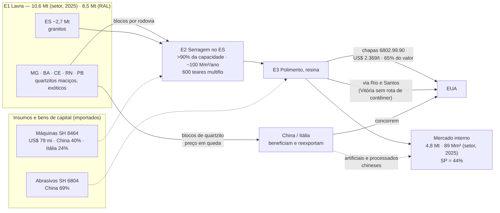

# Mapeamento da cadeia produtiva e da cadeia de valor das rochas ornamentais brasileiras — versão 2

**Data-base:** 12/10/2026 · **Dados:** ComexStat até set/2026; UN Comtrade até 2025; ANM (CFEM 2005–2026, RAL
2010–2025); 76 Informes e estudos setoriais fichados (Abirochas 2018–2026 e Centrorochas) ·
**Tabelas:** [anexo-estatistico.md](anexo-estatistico.md) (A1–A11) · **Leitura do setor, com trechos literais:**
[informes-setoriais.md](informes-setoriais.md)

> **O que mudou da v1.** (1) A hipótese de mix foi testada e confirmada: explica quase toda a alta do preço por
> tonelada. (2) Entrou a geografia da lavra (CFEM e RAL da ANM). (3) Entrou a leitura que o próprio setor faz de
> cada ciclo, extraída de 76 documentos, com 1.645 itens e trecho literal conferido automaticamente contra o PDF
> (0 descartados). (4) O choque tarifário foi detalhado por produto.
>
> **Regra de leitura.** "O setor atribui" = afirmação dos Informes (fonte interessada, não verificada de forma
> independente). "Dado" = série oficial. **Hipótese** = interpretação deste estudo, a confirmar.

---

## Sumário executivo

1. **US$ 1,475 bilhão exportado em 2025 (recorde nominal), 2,11 Mt.** O volume está 22% abaixo do pico de 2013.
2. **O preço das beneficiadas subiu por mix, não por preço.** De 2021 a 2025 o preço médio por tonelada foi de
   US$ 803 para 1.294 (×1,61). Decompondo por NCM de 8 dígitos: **efeito composição ×1,44, efeito preço dentro de
   cada produto ×1,12**. De 2013 a 2025 o preço dentro de cada produto ficou estável (×0,99) e todo o ganho veio da
   troca de produto. A troca tem nome: chapas da NCM 6802.99.90 (essencialmente quartzito maciço, segundo a
   Abirochas) passaram de 35% para **65% do valor beneficiado**, a US$ 2.369/t, contra US$ 608/t do granito
   (6802.93.90).
3. **Por isso, o crescimento depende de um único material e de um único mercado.** Quartzito em chapa, vendido
   sobretudo aos EUA (53,9% do valor total exportado em 2025). O próprio setor já aponta o limite: queda de preço
   do bloco de quartzito ("comoditização") e, em jan-abr/2026, a primeira queda de preço das chapas da 6802.99.90.
4. **A lavra se desloca para MG, BA e Nordeste; o beneficiamento continua no ES.** O Espírito Santo exporta 84% do
   valor, mas o setor afirma que o crescimento dos quartzitos "turbinou" a produção na Bahia, Ceará e norte de
   Minas, e que o ES concentra mais de 90% da capacidade de beneficiamento. A ANM não enxerga esse deslocamento:
   para 2024, o setor estima 2,1 Mt na Bahia, e o RAL registra ~0,45 Mt/ano (2022–2025).
5. **A produção declarada à ANM cobre só parte da produção estimada pelo setor.** RAL: 6,5–8,5 Mt (2023–2025);
   Abirochas: 10,0–10,6 Mt. No ES as duas fontes batem (~2,4–2,8 Mt); a diferença está fora do ES.
6. **O tarifaço de ago/2025 foi um choque concentrado em chapas para os EUA, depois amortecido.** As exportações de
   6802 para os EUA caíram de US$ 85 mi (jul/25) para 35 mi (ago/25) e voltaram a 59–93 mi/mês em 2026. Segundo a
   Abirochas, a nova tarifação dos EUA "acabou por isentar" a NCM 6802.99.90. O 1º bimestre de 2026 caiu forte
   (estoques antecipados em 2025) e o setor fala em "momento desafiador".
7. **A tese estrutural do setor:** o ciclo exportador de blocos e chapas "já teria alcançado o seu limite de
   expansão"; só produtos acabados para obras romperiam a estagnação. A estratégia que o setor chama de "Terceira
   Onda Exportadora", voltada a esses produtos, foi descontinuada, segundo o próprio setor.

---

## 1. Escopo, fontes e método

Inalterados da v1 (recorte NCM validado contra a Abirochas, 11 elos, US$ correntes), com três fontes novas:

| Fonte | O que mede | Limite |
|---|---|---|
| ANM — CFEM 2005–2026 (anexo A9) | royalty recolhido por substância e município: geografia da lavra formal | não separa granito ornamental de brita; quebra de série em 2017–2018 (Lei 13.540/2017) |
| ANM — RAL 2010–2025 (anexo A10) | produção bruta e venda declaradas pelas minas | só minas tituladas; 2024 com provável erro de declaração (ES 12,6 Mt) |
| Informes Abirochas e documentos Centrorochas (76) | estimativas de produção, consumo, emprego; atribuição de causas | fonte interessada; números estimados pela associação |

**Fichamento.** LLM segundo `prompts/triagem.md` §D; cada item tem trecho literal, conferido por
`cinzenta_tabela.py` (normalização de espaços e ligaduras). Dos 323 PDFs com texto, 221 são só tabelas de comércio
exterior (repetem o ComexStat) e foram excluídos do fichamento. Auditoria manual de uma amostra de 12 explicações:
10 coerentes com o trecho; 2 fracas (registro de um fenômeno sem causa explícita; previsão condicional tomada como
explicação). Taxa de atribuição fraca estimada: **~15%** — a tabela de explicações é material de pesquisa, não
citação pronta.

---

## 2. Mapa da cadeia produtiva (atualizado)

_Números de lavra, capacidade, teares e consumo interno: estimativas da Abirochas (Informes 01/2024 e 01/2026),
não séries oficiais._

---

## 3. Os elos com números

### E1 · Lavra — onde se extrai

**Dado (ANM).** Produção bruta declarada (RAL): 3,5 Mt (2010) → 6,5 Mt (2023) → 8,5 Mt (2025); ES responde por
35–50%. Valor de venda na mina: R$ 404 mi (2010) → R$ 3,7 bi (2025), nominais. CFEM atribuível a rocha ornamental:
R$ 5,4 mi (2005) → R$ 33,4 mi (2025).

**Estimativa do setor.** Produção de 10,6 Mt em 2025, das quais quartzito maciço 3,0 Mt (28%) e granitos 3,3 Mt
(31%). Em 2020 o quartzito maciço era 1,5 Mt (16,7%): **dobrou em cinco anos**.

**Divergência que importa.**

| | ES | BA | Brasil |
|---|---|---|---|
| Abirochas (2024) | 2,4 Mt | 2,1 Mt | 10,5 Mt |
| RAL/ANM (média 2022–2025, sem 2024) | ~2,5 Mt | ~0,45 Mt | ~7,4 Mt |

No ES as fontes convergem; na Bahia o setor estima quase cinco vezes o que as minas declaram. **Hipótese:** lavra
de quartzito no Nordeste com titulação ou declaração incompleta ao RAL. Implicação para o estudo: o deslocamento
da lavra para o Nordeste, que o setor descreve, **não é mensurável com dado oficial hoje**; a CFEM e o RAL
subestimam exatamente a fronteira em expansão.

**Fechamento de pedreiras.** O setor atribui a paralisação de "dezenas de frentes de lavra, especialmente no estado
do Espírito Santo" à "perda de economicidade de vários materiais comuns ou de batalha" (Informe 01/2024). A CFEM do
ES confirma queda no período, mas a quebra de série da Lei 13.540/2017 impede separar efeito legal de efeito
produtivo antes de 2018.

### E2–E3 · Beneficiamento

- **Capacidade (setor):** ~100 Mm²/ano de chapas (2023), 600 teares multifio diamantados (350 nacionais); o ES
  concentra mais de 90% da capacidade (Informe 12/2025). Em 2020 eram 470 multilâmina e 360 multifio, ou seja,
  houve troca de tecnologia na década.
- **Ociosidade:** o setor relata "ociosidade do parque de serragem" (2023) e alerta que a queda das chapas em 2026 "pode resultar em uma
  acentuação da capacidade ociosa na serragem de blocos" (Informe 3/2026).
- **Teste da hipótese da v1 — confirmado.** O preço das beneficiadas subiu por composição. Decomposição por NCM-8
  (ComexStat):

| Período | Preço médio (US$/t) | Efeito preço dentro do produto | Efeito composição |
|---|---|---|---|
| 2013 → 2025 | 811 → 1.294 | ×0,99 | **×1,61** |
| 2019 → 2025 | 727 → 1.294 | ×1,15 | **×1,54** |
| 2021 → 2025 | 803 → 1.294 | ×1,12 | **×1,44** |

| NCM | Produto | 2021 | 2025 |
|---|---|---|---|
| 6802.99.90 | chapas "outras pedras" (quartzito maciço) | US$ 353 mi · 35% · 2.164 US$/t | **US$ 695 mi · 65% · 2.369 US$/t** |
| 6802.93.90 | chapas de granito | US$ 475 mi · 46% · 550 US$/t | US$ 273 mi · 26% · 608 US$/t |
| 6802.91.00 | mármore trabalhado | US$ 94 mi · 9% | US$ 51 mi · 5% |

  Ressalva: 6802.99.90 é código residual; a afirmação de que corresponde a quartzito maciço é da Abirochas
  (Informe 06/2025: 58,2% das exportações aos EUA em 2024 por esse código). Dentro do código ainda pode haver mix.

### E4 · Insumos e bens de capital

Sem mudança da v1: máquinas e abrasivos importados, com a China substituindo a Itália. O setor contabiliza 350 dos
600 teares multifio como nacionais (2023): **o elo de máquinas é menos importado do que a v1 sugeria** — a proxy
SH 8464 capta o fluxo de importação, não o estoque instalado.

### E5 · Logística — agora com evidência

O setor repete a mesma explicação em 2018, 2019, 2021, 2022, 2023, 2024 e 2025: o porto de Vitória não atende a
carga conteinerizada de chapas. Trechos:
- "Vitória continuou assim evidenciando deficiências logísticas para embarque das chapas produzidas no estado"
  (Informe 01/2022).
- A taxa de utilização do terminal de contêiner "corresponde a 155% da sua capacidade natural", com "aumento no tempo de estadia das
  embarcações de contêineres, alteração de rotas de embarcações, cancelamentos de embarques" (Centrorochas, carta
  aberta, 12/07/2024).
- Consequência medida pelo próprio setor: Vitória exporta sobretudo blocos (US$ 210/t em jan-abr/2024); chapas saem
  por Rio de Janeiro e Santos (Informes 04/2024, 10/2025, 12/2025).

**Hipótese:** o custo logístico é parte do diferencial de preço Brasil × Itália no mercado americano (v1, achado
4). Testável com dado de frete (ANTAQ), ainda não coletado.

### E6 · Comercialização e exportação

- **Choque tarifário por produto:**

| Mês | Exportação total, com quartzito bruto (US$ mi) | 6802 para os EUA (US$ mi) |
|---|---|---|
| jul/2025 | 147 | 85 |
| ago/2025 | 97 | **35** |
| set–dez/2025 | 105–140 | 51–71 |
| jan–fev/2026 | 80–93 | 31–47 |
| mar–set/2026 | 105–163 | 45–93 |

  O setor atribui a alta de jan-jul/2025 à "antecipação de importações pelos EUA, no sentido de evitar os efeitos
  diretos e indiretos do tarifaço" (Informe 08/2025) e a queda do início de 2026 ao esgotamento desses estoques.
  Segundo o Informe 12/2025, a tarifação "acabou por isentar" a NCM 6802.99.90. **A confirmar** no ato do governo
  dos EUA (Federal Register / HTSUS 6802.99.00) antes de citar.
- **China como destino de blocos de quartzito e reexportadora.** Exportações para a China +44% em valor e +10% em
  peso (1º tri/2026), o que atesta, segundo o setor, a "crescente e já grande participação de blocos de quartzito";
  e "uma quantidade cada vez maior de rochas brasileiras está sendo processada na China e posteriormente
  comercializada no mercado internacional" (Informe 3/2026).
- **México:** 4º comprador em 2023, explicado pelo setor como "nearshore trading" com os EUA (Informe 01/2024).

### E7 · Mercado consumidor

- **Interno (estimativa do setor):** 4,8 Mt ou 89,3 Mm² equivalentes em 2025; 22,7 kg/hab; São Paulo 44%.
  Destino de 74% da produção (7,9 Mt). **O mercado interno é maior que o externo em volume**, e a v1 não o media.
- **Ameaça interna declarada:** "crescente pressão de produtos chineses, especialmente materiais artificiais de
  revestimento, no mercado interno, o que pode restringir a produção e o consumo dos granitos nacionais mais comuns"
  (Informe 01/2026). O setor também afirma que a perda de fatia é "até mais evidenciada pelos porcelanatos do que
  pelos chamados materiais rochosos artificiais" (Informe 01/2022).

### E8 · Resíduos

O setor passou a tratar o tema como desafio competitivo: "O grande desafio competitivo, agora colocado para o setor
de rochas, é o da sustentabilidade ambiental, centrada no aproveitamento dos rejeitos/resíduos" (Informe 01/2024). E
liga a ascensão chinesa nos artificiais a uma política pública: a "obrigatoriedade de aproveitamento dos rejeitos do
setor de rochas, imposta pelo governo chinês" (idem). **A confirmar** com fonte chinesa.

### E9 · Trabalho

Estimativa do setor: 150 mil empregos diretos e 12 mil empresas (2023); em 2017–2020, 120 mil diretos e 10 mil
empresas, mais de 60% marmorarias. **Sem dado oficial** (RAIS/CAGED não incorporados).

---

## 4. Cadeia de valor: onde o valor é capturado (revisado)

| Estágio | US$/t | Fonte |
|---|---|---|
| Bloco silicático exportado (média) | 302 (2025) | ComexStat |
| Chapa de granito (6802.93.90) | 608 (2025) | ComexStat |
| Chapa de quartzito/outras (6802.99.90) | 2.369 (2025) | ComexStat |
| Beneficiada exportada pela Itália | 2.027 (2024) | Comtrade |

**Revisão do achado 4 da v1.** A v1 comparou o preço médio brasileiro (US$ 1.088/t) com o italiano (2.027) e
levantou a hipótese de captura de valor em marca/distribuição. Com o detalhamento por NCM, o quadro muda: **o
quartzito brasileiro em chapa já é vendido acima do preço médio italiano**; o que puxa a média brasileira para baixo
é o granito comum (US$ 608/t), que é justamente o produto em declínio. O diferencial é, em boa parte, de mix. A
hipótese de marca/distribuição continua válida para o granito, não para o quartzito.

**Duas ameaças ao único motor de valor:**
1. **Comoditização do bloco de quartzito.** Volume exportado em alta com preço em queda (−6,8% no 1º quadrimestre
   de 2025), que o setor lê como "processo indesejável de comoditização destes produtos comerciais, que deverá
   futuramente estender-se para suas chapas" (Informe 05/2025). Em jan-abr/2026, primeira queda de preço da
   6802.99.90 (Informe 5/2026).
2. **Venda do bloco ao concorrente.** O mesmo material sai como bloco para a China, que o processa e compete no
   mercado final (Informe 3/2026).

---

## 5. Polos: exportação × lavra

| | Exportação (ComexStat, 2025) | CFEM ornamental (2025) | RAL (2025) | Estimativa do setor |
|---|---|---|---|---|
| ES | 84,1% | 17,6% | 32% | 2,4 Mt (2024) |
| MG | 9,2% | 14,1% | 16% | — |
| BA | 1,2% | — | 5% | 2,1 Mt (2024) |

A distância entre a coluna de exportação e as de lavra é o mapa da cadeia: **o ES beneficia e exporta o que MG, BA
e o Nordeste extraem**. A fatia do ES na CFEM depende da lista de municípios do polo, ainda a validar (anexo A9):
Pinheiros, Afonso Cláudio, Rio Bananal, Governador Lindenberg e Itaguaçu recolhem CFEM de "granito" e estão fora da
lista.

---

## 6. Evolução 1997–2026 com a leitura do setor

| Fase | Exportação | O setor atribui a… |
|---|---|---|
| Expansão 2000–2008 | 265 → 953 US$ mi | chapas polidas para os EUA e blocos para a China; deslocamento mundial da produção para fora da Europa |
| Crise 2009 | −24% | estouro da bolha imobiliária dos EUA |
| Pico 2011–2014 | 2,72 Mt (2013) | recomposição de estoques nos EUA, construção chinesa, teares multifio e real desvalorizado |
| Estagnação 2014–2020 | 1.301 → 987 | avanço de artificiais e porcelanatos nos EUA; China desacelerando; custo Brasil |
| Recuperação 2021–2022 | 1.336 | pacotes anticíclicos nos EUA; quartzitos e mármores de maior valor; câmbio |
| Recuo 2023 | 1.112 | juros nos EUA, crise imobiliária chinesa, frete e conflitos; fechamento de pedreiras de granito comum |
| Antecipação 2024–jul/2025 | 1.475 (2025) | compras dos EUA antes do tarifaço |
| Choque ago/2025–2026 | 12 m: 1.462 | tarifaço, estoques antecipados, competição chinesa; "momento desafiador" |

---

## 7. Achados para a agenda do estudo

| # | Achado | Grau de evidência |
|---|---|---|
| 1 | Alta do preço/t é composição (quartzito), não preço | **dado validado** (decomposição NCM-8) |
| 2 | Motor de valor único: quartzito em chapa para os EUA | dado validado |
| 3 | Comoditização do bloco de quartzito | preço do bloco em queda: dado do setor; a reproduzir com NCM 2506.20 por país |
| 4 | Lavra se desloca para MG-BA-NE; beneficiamento fica no ES | afirmação do setor; **dado oficial não capta** (RAL/CFEM subestimam a BA) |
| 5 | Logística de Vitória como restrição recorrente | afirmação reiterada do setor e da Centrorochas; falta dado de frete |
| 6 | Diferencial de preço Brasil × Itália é sobretudo mix | dado validado (revisa hipótese da v1) |
| 7 | Mercado interno = 74% do volume, sob pressão de artificiais chineses | estimativa do setor |

---

## 8. Lacunas e próximos passos

| Lacuna | Gravidade | Caminho |
|---|---|---|
| Produção da BA e do Nordeste (RAL subestima) | **material** | SIGMINE (títulos ativos por substância e município) + entrevista com o setor |
| Emprego por elo | **material** | RAIS/CAGED (CNAE 0810, 2391) |
| Frete e custo portuário | material | ANTAQ (movimentação de contêineres por porto e mercadoria) |
| Isenção da 6802.99.90 na tarifa dos EUA | material | Federal Register / HTSUS — confirmar antes de citar |
| Lei 13.540/2017: alíquota de rochas ornamentais | moderada | conferir texto legal (quebra da série CFEM) |
| Lista de municípios do polo | moderada | validação com o setor |
| Informes de 2017 e anteriores a 2016 | moderada | rodada de PDFs prioritários (agendada 2×/semana) |
| Triagem PRISMA da literatura | moderada | `prompts/triagem.md` §A |

---

## 9. Ressalvas

- US$ e R$ correntes, sem deflação.
- Estimativas da Abirochas (produção, consumo, emprego, capacidade) são da associação, com método não publicado nos
  documentos lidos; usar como ordem de grandeza.
- A tabela de explicações reproduz o que o setor **atribui**; ~15% das atribuições da amostra auditada são fracas.
- O RAL 2024 tem provável erro de declaração (ES 12,6 Mt) e foi excluído das médias.
- UF no ComexStat é a do exportador, não a da lavra.
